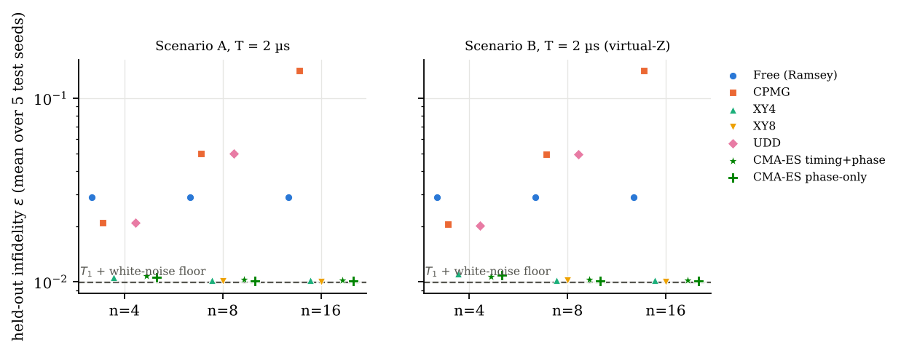
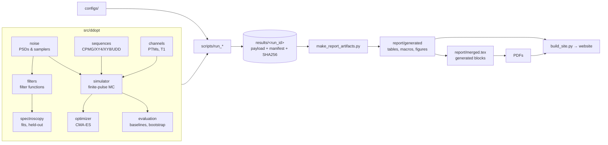

<div align="center">

# Quantum DD Optimizer

### Model-based dynamical decoupling for idle superconducting qubits
#### A reproducible, pre-registered synthetic benchmark with hardware timing constraints

**Christian De Zabala F. · Madeline Feldner · Zarar Haider · Udaya Vijay Anand**<br>
Columbia University

[](https://github.com/udsy19/quantum-dd-optimizer/actions/workflows/ci.yml)
[](https://github.com/udsy19/quantum-dd-optimizer/actions/workflows/pages.yml)
[](https://github.com/udsy19/quantum-dd-optimizer/releases)
[](LICENSE)


[**Read the paper online**](https://udsy19.github.io/quantum-dd-optimizer/) ·
[**Download complete PDF (paper + appendix)**](https://github.com/udsy19/quantum-dd-optimizer/releases/download/v0.1.1/quantum-dd-optimizer-paper-with-appendix.pdf) ·
[**5-page paper PDF**](https://github.com/udsy19/quantum-dd-optimizer/releases/download/v0.1.1/quantum-dd-optimizer-paper.pdf) ·
[All release assets](https://github.com/udsy19/quantum-dd-optimizer/releases/latest) ·
[Paper source](report/merged.tex) ·
[Experiment plan](docs/EXPERIMENT_PLAN.md) ·
[Red-team review](docs/REVIEW_FINDINGS.md)

</div>

> [!IMPORTANT]
> **All results are simulations of a synthetic model.** No quantum hardware (IQCC or other) has been
> accessed or used, and no measured data exist. "CMA-ES" is an evolution strategy, not reinforcement
> learning. A zero or negative gain is a valid outcome here, and it is the main finding.

---

## Overview

An idle qubit waiting while a neighbour is measured mid-circuit loses coherence to stochastic
dephasing and picks up deterministic phase from readout-induced frequency shifts. Dynamical
decoupling (DD) counters both. We ask a narrow question: **does model-based optimization of DD
pulse timings and phases with CMA-ES beat strong canonical sequences when the comparison is fair?**

Fair means: equal idle window *T*, pulse count *n*, pulse width, guard spacing, controller grid
and frame-correction privileges; the strongest baseline chosen by a **pre-registered,
training-only rule**; and every arm scored on **independent held-out noise**.

<p align="center">
  
  <br><sub>Held-out infidelity at equal n and T = 2 µs. XY4/XY8 already sit at the analytic T₁ + white-noise floor (dashed), so optimization has nothing left to remove. Generated by <code>scripts/make_report_artifacts.py</code> from pinned runs.</sub>
</p>

## Key results

| Question | Answer (synthetic model, held-out noise) |
|---|---|
| Does the finite-pulse Monte-Carlo simulator agree with filter-function theory? | **Yes.** All 5 pre-registered cases agree within 1.96 SE (max \|z\| = 0.95). |
| Can synthetic Ramsey/Hahn/CPMG spectroscopy recover a *predictive* noise model? | **Yes for prediction** (held-out RMSE 1.15× the shot-noise floor, 95 % coverage 0.934); **no for unique spectrum reconstruction**. |
| Does CMA-ES beat the strongest canonical DD (XY4/XY8) in the pre-registered Scenario A? | **No.** XY8 reaches 1.00×10⁻², essentially the T₁ + white-noise floor of 9.90×10⁻³. |
| With a deterministic readout-like Stark shift + virtual-Z (Scenario B)? | Nominal gains of 2–5 % at n = 4 only. The timing+phase variant **reverses** under ±100 ns timing shifts (worst case 2.11×10⁻² vs 1.13×10⁻² for XY4 + virtual-Z); phase-only stays marginally better, model-specific. |
| Do more headroom or fitted noise models help? | **No.** Training gains do not generalize; they come from fitting the frozen training noise draws. |

Every number above is generated from checksum-verified runs pinned in
[`report/runs.json`](report/runs.json) and traced in [`report/evidence_map.csv`](report/evidence_map.csv).

## Contents

- [Paper and website](#paper-and-website)
- [Installation](#installation)
- [Quick start](#quick-start)
- [Reproducing the study](#reproducing-the-study)
- [Architecture](#architecture)
- [Physics conventions](#physics-conventions)
- [Scientific integrity](#scientific-integrity)
- [Hardware status](#hardware-status)
- [FAQ](#faq)
- [Roadmap](#roadmap)
- [Team](#team)
- [Citing](#citing)
- [Contributing, releases, security](#contributing-releases-security)
- [License](#license)
- [Editing the paper (GitHub and Overleaf)](#editing-the-paper-github-and-overleaf)

## Paper and website

| | |
|---|---|
| **Online paper** | https://udsy19.github.io/quantum-dd-optimizer/ |
| **Source** | [`report/merged.tex`](report/merged.tex): the single canonical manuscript (IEEE paper, ≤ 6 pages, plus an S-numbered supplement) |
| **PDFs** | Not tracked in git. CI artifacts (**Actions → run → Artifacts → report-pdf**), the PDF links on the website, and [Release](https://github.com/udsy19/quantum-dd-optimizer/releases) assets: `combined_report.pdf` (submission PDF, paper + supplement), `main.pdf`, `appendix.pdf` |
| **Build** | `PYTHON=python bash scripts/build_report.sh` (needs `latexmk`, `texlive-publishers`, `poppler-utils`) |

The website is generated from the same sources: the paper text is rendered from `report/` at
build time, numbers come from the pinned runs, and the figures are interactive. Every push to
`main` rebuilds and redeploys it via [`.github/workflows/pages.yml`](.github/workflows/pages.yml),
so editing `report/` updates the site automatically.

## Installation

Requires Python ≥ 3.11 (tested on 3.11 and 3.13).

```bash
git clone https://github.com/udsy19/quantum-dd-optimizer.git
cd quantum-dd-optimizer
python -m venv .venv && source .venv/bin/activate
pip install -e ".[test]"
python -m pytest -q
```

Exact versions used for the recorded runs are in [`requirements-lock.txt`](requirements-lock.txt).
Optional tools: `latexmk` + TeX Live (`texlive-publishers`) and `poppler-utils` for the paper,
and `pandoc` for the website.

## Quick start

```python
from ddopt import sequences, simulator
from ddopt.scenarios import load_scenario, scenario_noise, sim_config

cfg = load_scenario("scenario_a")                 # synthetic assumptions, see configs/
noise = scenario_noise(cfg)
seq = sequences.xy8(8, T=2e-6, width=32e-9, guard=4e-9, dt_grid=4e-9)
res = simulator.simulate(seq, noise, sim_config(cfg, seed=1, n_traj=512))
print(f"{res.infidelity:.3e} ± {res.infidelity_stderr:.1e}")
```

Analytic filter-function prediction for the same noise model:

```python
from ddopt import filters
chi, err = filters.dephasing_variance(noise, seq)   # χ = (1/2π) ∫ S₂(ω) |Y(ω)|² dω
```

## Reproducing the study

Each experiment script writes a new immutable `results/<run_id>/` (payload, manifest with git
state / package versions / seeds / command, `SHA256SUMS`) and refuses to overwrite.

```bash
python scripts/run_g3_validation.py --n-traj 64000                 # Monte Carlo vs filter function
python scripts/run_spectroscopy.py                                 # synthetic spectroscopy, held-out scoring
python scripts/run_benchmark.py --scenario scenario_a              # pre-registered benchmark
python scripts/run_benchmark.py --scenario scenario_b --robustness # Stark shift + robustness sweep
python scripts/run_benchmark.py --scenario scenario_a --T 4e-6 --name benchmark_scenario_a_T4us
python scripts/run_model_based.py --spectroscopy-run <spectroscopy run id>
python scripts/run_convergence.py --scenario scenario_a --n 8      # exploratory diagnostic
python scripts/run_tests_recorded.py                               # stores the test-suite outcome

python -m ddopt.provenance verify results/<run_id>                 # verify checksums
python scripts/make_report_artifacts.py                            # figures, tables, number macros, ledger
python scripts/manuscript.py sync-generated --write                # copy generated blocks into report/merged.tex
python scripts/make_evidence_map.py                                # refresh the claim ledger
bash scripts/build_report.sh                                       # paper PDFs (runs manuscript.py check)
python scripts/build_site.py                                       # website → site/dist/
```

Approximate wall time on 4 CPU cores: Scenario A ≈ 5 min; Scenario B with robustness ≈ 20 min;
G3 validation ≈ 7 min; spectroscopy ≈ 2–6 min.

## Architecture



| Module | Purpose |
|---|---|
| `noise` | Two-sided PSD models (1/f, Lorentzian/OU, white, telegraph) and exact samplers |
| `filters` | Switching and generalized vector filter functions; χ quadrature with error estimates |
| `channels` | Pauli-transfer-matrix channels, amplitude damping, average gate fidelity |
| `sequences` | Free, Hahn, CPMG, XY4, XY8, UDD with feasibility, guard and grid validation |
| `simulator` | Finite-pulse Monte-Carlo propagation, noise-averaged channel, virtual-Z |
| `spectroscopy` | Synthetic Ramsey/Hahn/CPMG data, binomial-likelihood fits, held-out scoring |
| `optimizer` | CMA-ES (pycma 4.5.0) over gaps/phases with target-preserving phase projection |
| `evaluation` | Baselines, pre-registered selection, paired block bootstrap, Scenario B arms |
| `provenance` | Immutable run directories with manifests and SHA-256 checksums |
| `contracts` | Typed public data contracts (`docs/INTERFACES.md`) |
| `qua/` | SDK-free QUA schedule adapter: a template, **not hardware tested** |

```
src/ddopt/   library                      tests/    unit, integration, reproducibility, site tests
configs/     synthetic scenario configs   scripts/  experiment, report and site entry points
results/     immutable recorded runs      figures/  generated figures
report/      merged.tex (paper + supp.)   site/     website source (built to site/dist in CI)
qua/         gated QUA adapter            docs/     plan, conventions, physics, review, audits
```

## Physics conventions

ħ = 1; times in s; angular frequencies and detunings in rad/s; **two-sided** PSD
S₂(ω) = ∫ C(τ) e^{−iωτ} dτ in rad²/s; Y(ω) = ∫₀ᵀ y(t) e^{iωt} dt; χ = (1/2π) ∫ S₂ |Y|² dω;
W = e^{−χ/2} (Gaussian); pure-dephasing infidelity r = (1 − W)/3; amplitude damping γ = 1 − e^{−t/T₁}
with r_AD = (2 + γ − 2√(1−γ))/6; F_avg = (Tr R + 2)/6; fidelity graded against the ideal net control
unitary, plus virtual-Z where allowed. Full statement: [`docs/PHYSICS_CONVENTIONS.md`](docs/PHYSICS_CONVENTIONS.md);
derivations and measured tolerances: [`docs/PHYSICS.md`](docs/PHYSICS.md).

## Scientific integrity

- **Pre-registration.** Scenarios, seeds, baselines, the selection rule and metrics were committed before any optimization run ([`docs/EXPERIMENT_PLAN.md`](docs/EXPERIMENT_PLAN.md)). Deviations are logged there, including one plumbing smoke run that touched held-out seeds and the post-hoc exploratory ablations.
- **No mutable "latest".** The paper and website read only runs pinned in [`report/runs.json`](report/runs.json), verified by checksum. The website build fails if any of its numbers disagrees with the stored payloads.
- **Independent review.** A red-team pass re-derived the conventions, reproduced numbers bit-for-bit and found no critical defect; its high-severity finding is incorporated ([`docs/REVIEW_FINDINGS.md`](docs/REVIEW_FINDINGS.md)). Human review of the evidence ledger is pending.
- **Known limitations.** Synthetic Gaussian stationary noise; Scenario B models a deterministic shift only (no measurement-induced dephasing); T₁ during pulses is approximated. The public references were identity-checked against their arXiv records; publisher pagination and DOIs are not fully audited ([`docs/CITATION_AUDIT.md`](docs/CITATION_AUDIT.md)).

## Hardware status

**Not run.** There is no IQCC access, authorization, calibration or run ID. `qua/` translates a
`PulseSequence` into a clock-cycle schedule and, if the QM SDK is installed, a QUA program object.
It never opens a connection or executes anything. Protocols and gates for prospective, authorized
hardware work are in [`docs/HARDWARE_PROTOCOL.md`](docs/HARDWARE_PROTOCOL.md).

## FAQ

**So CMA-ES doesn't work for dynamical decoupling?**
That is not what this shows. Under this synthetic model, with this parameterization (CMA-ES starts
from CPMG, ≤ 2000 evaluations, 256 training trajectories), the optimized sequences did not
generalize better than XY4/XY8. In the pre-registered scenario, XY8 is already at the physical floor.

**Why is the main result negative?**
Because the comparison was fair and held out. Training-set gains appeared and then vanished on
independent noise draws; see the convergence diagnostic in the paper.

**Can I trust a number in the paper or on the site?**
Each one maps to a run directory, a command and a commit in [`report/evidence_map.csv`](report/evidence_map.csv),
and `python -m ddopt.provenance verify` checks the stored data.

**Has any of this run on a real qubit?**
No. See [Hardware status](#hardware-status).

## Roadmap

1. With authorization, measure T₁, Ramsey, Hahn and CPMG decays and spectator phase during neighbour readout on the target device, to learn whether the decouplable colored component is large enough for optimization to matter at all.
2. Model measurement-induced dephasing as non-stationary noise and repeat Scenario B.
3. Regularize the optimizer (more training trajectories, robust objectives, starting from XY8) and pre-register a new held-out benchmark.

## Team

| | Affiliation |
|---|---|
| Christian De Zabala F. | Columbia University: Computer Science, Economics |
| Madeline Feldner | Columbia University: Computer Science, Statistics |
| Zarar Haider | Columbia University: Computer Science |
| Udaya Vijay Anand | Columbia University: Electrical Engineering |

The project was motivated by a Columbia University × Quantum Machines course project-ideas brief.
That brief describes other work and is not evidence of this implementation or of hardware access.
Individual contribution attributions await confirmation by all four authors.

## Citing

Use GitHub's **"Cite this repository"** button, which is generated from [`CITATION.cff`](CITATION.cff), or:

```bibtex
@software{quantum_dd_optimizer_2026,
  title   = {Quantum DD Optimizer: model-based dynamical decoupling under hardware timing constraints (synthetic study)},
  author  = {De Zabala F., Christian and Feldner, Madeline and Haider, Zarar and Vijay Anand, Udaya},
  year    = {2026},
  version = {0.1.1},
  url     = {https://github.com/udsy19/quantum-dd-optimizer}
}
```

## Contributing, releases, security

- [CONTRIBUTING.md](CONTRIBUTING.md): development setup, evidence rules, pull-request checklist
- [CODE_OF_CONDUCT.md](CODE_OF_CONDUCT.md): expected behaviour
- [RELEASING.md](RELEASING.md) and [CHANGELOG.md](CHANGELOG.md): versioning and release procedure
- [SECURITY.md](SECURITY.md): private vulnerability reporting; never commit credentials or device configurations
- [docs/ABOUT.md](docs/ABOUT.md): project background

## License

[MIT](LICENSE) © 2026 Udaya Vijay Anand. Team material beyond this repository requires the authors' consent before publication.

## Editing the paper (GitHub and Overleaf)

**`report/merged.tex` is the single canonical manuscript** (main paper and supplement in one file).
Edit it on GitHub or in Overleaf. CI only compiles it and uploads artifacts; it never commits
anything back.

- The team's Overleaf project is linked to this repository via Overleaf's GitHub Synchronization.
  Sync is **manual both ways** (Overleaf **Menu → Integrations → GitHub**: pull before you edit,
  push when done). Set **Settings → Main document** to `report/merged.tex`.
- Without premium sync: upload `overleaf-project.zip` from the CI artifact (**New Project → Upload
  Project**) and bring changes back to GitHub in a PR.
- Never hand-edit numbers or the `% >>> BEGIN GENERATED` blocks; regenerate with the scripts and run
  `python scripts/manuscript.py check`.

Paper contributors and AI agents must read the
**[LaTeX and Overleaf editing guide](docs/LATEX_OVERLEAF_AGENT_GUIDE.md)** first. It covers the
exact sync steps, conflict handling, generated values, figures and build checks.
